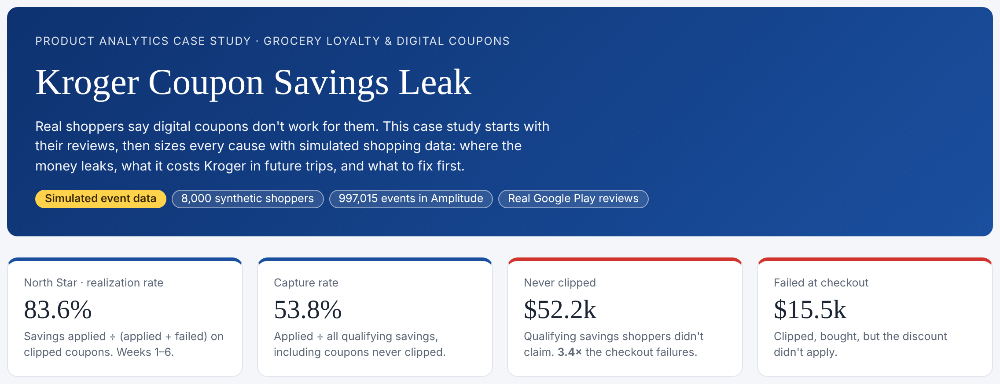
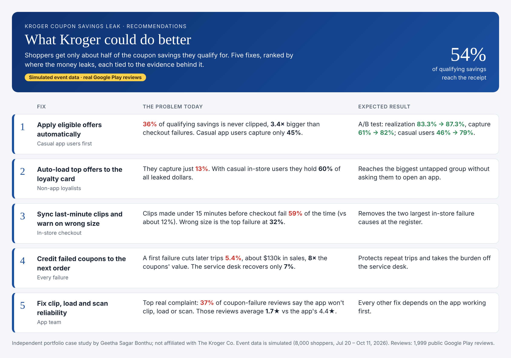
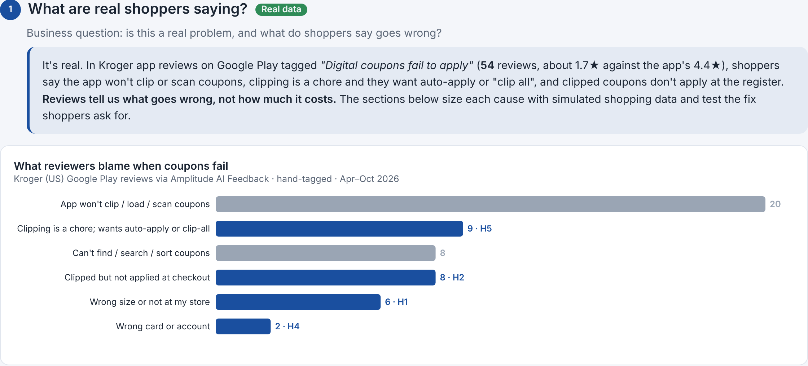
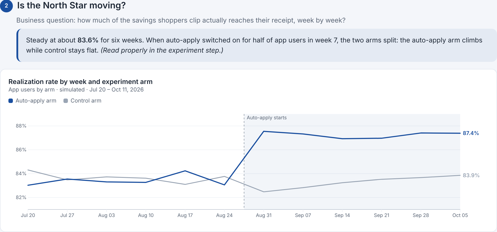
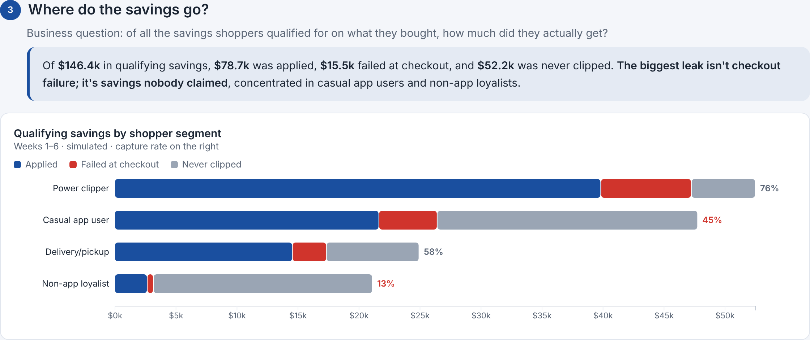
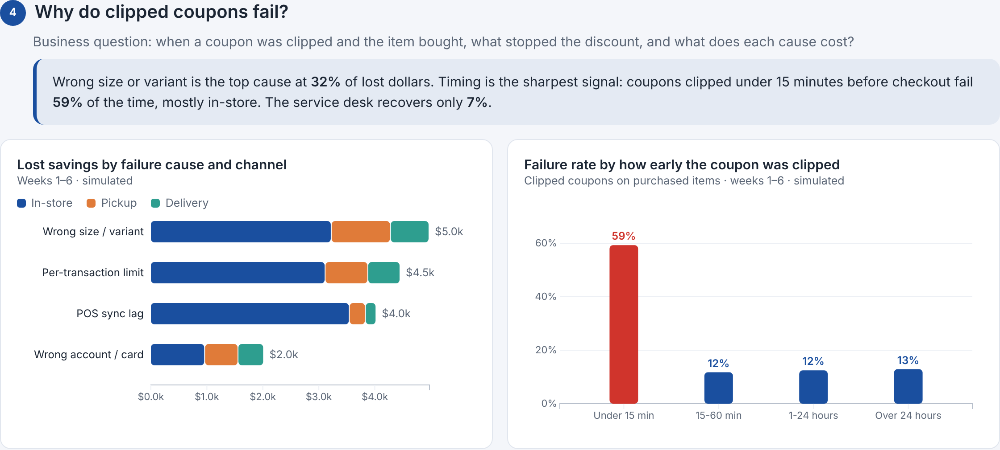
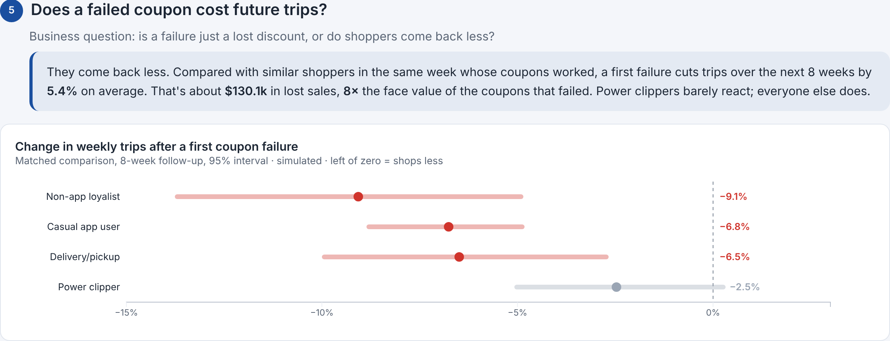
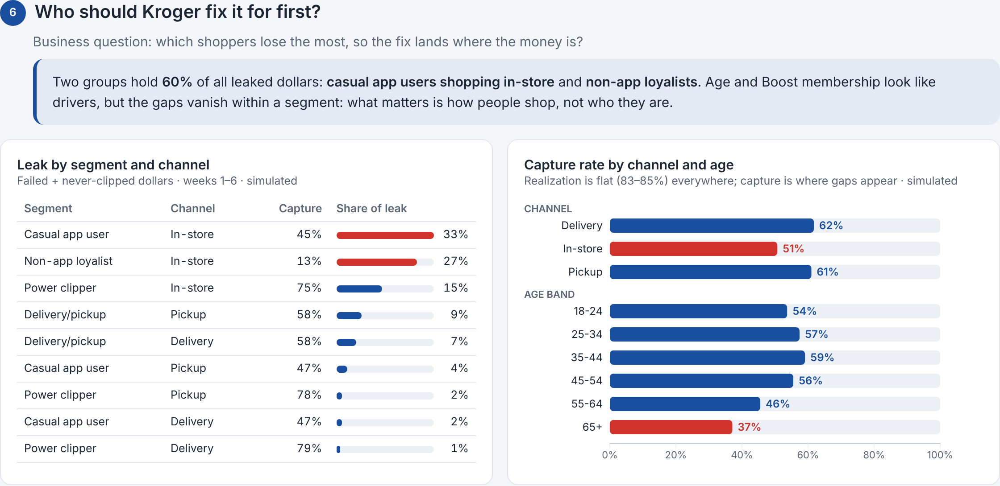
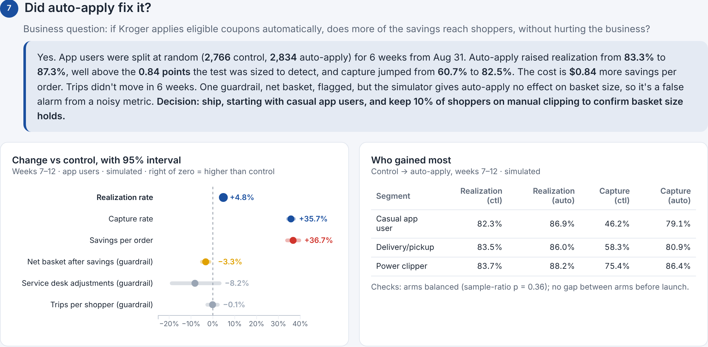

# Kroger Coupon Savings Leak


A retail product and marketing analytics case study. App events for 8,000 shoppers (997k events) were simulated in Python and loaded into Amplitude, and 1,999 real Google Play reviews of the Kroger app were pulled with Amplitude AI Feedback.
I built the first analysis in Amplitude (funnels, retention, segments, dashboards). The work then moved to Claude for the in-depth analysis: sizing the leak in dollars, a matched retention comparison, and the auto-apply A/B test readout.

> **Simulated data.** All event data is simulated in Python (8,000 shoppers, 997k events, seed 42). No real Kroger data is used. Customer evidence comes from real, public Google Play reviews.
> Independent portfolio project; not affiliated with or endorsed by The Kroger Co.

**How much digital-coupon savings do grocery shoppers lose, where, and what fixes it?**

## The problem

Shoppers clip digital coupons in the app, but the discount doesn't always apply at the register, and many qualifying offers are never clipped at all. Real reviews back this up: across 1,999 Google Play reviews of the Kroger app, *Digital coupons fail to apply* ranks #10 of 686 feedback themes (54 reviews, 1.7★ vs the app's 4.4★).

**North Star:** Coupon Savings Realization Rate = savings applied ÷ (savings applied + savings failed).



## What Kroger could do better



## Results

| Question | Answer |
| --- | --- |
| How much of the savings shoppers qualify for do they get? | **54%** ($78.7k of $146.4k in 6 weeks) |
| Where does the rest go? | **36% never clipped** ($52.2k), 11% failed at checkout ($15.5k): never-clipped is 3.4× bigger |
| Why do clipped coupons fail? | Wrong size 32%, per-transaction limit 29%, POS sync lag 26%, wrong account 13%; clips made <15 min before checkout fail 59% of the time |
| Does a failure hurt the business? | A first failure cuts later trips **5.4%** over 8 weeks (matched comparison), ≈$130k in sales, 8× the coupons' face value |
| Who should we fix it for first? | Behavior, not demographics: casual app users in-store and non-app loyalists hold 60% of leaked dollars |
| Does auto-apply work? | 6-week A/B test: realization **83.3% → 87.3%** (+4.0 pts, 95% CI +3.5 to +4.5), capture 61% → 82%, guardrails hold |

## The analysis, step by step

Each step answers one business question. Event-based charts are simulated; step 1 is real.

**1. Is this a real problem?** Shoppers blame app reliability first, then manual clipping, then coupons that don't apply at the register.


**2. Is the North Star moving?** Flat near 84% for six weeks, then the auto-apply arm separates from control.


**3. Where do the savings go?** The biggest leak is savings nobody clipped, not checkout failures.


**4. Why do clipped coupons fail?** Wrong size leads; last-minute clips fail 59% of the time.


**5. Does a failure cost future trips?** Yes: 5.4% fewer trips over 8 weeks, about 8× the coupons' value.


**6. Who should Kroger fix it for first?** Casual app users in-store and non-app loyalists hold 60% of leaked dollars.


**7. Did auto-apply fix it?** Realization +4.0 points, capture +21.7 points, guardrails hold.


## What's in this repo

```
docs/
  01_tracking_plan.md               10 events, 7 user properties, known gaps
  02_analysis_memo.md               findings and recommendations (start here)
  03_experiment_brief_and_readout.md  auto-apply A/B test: plan, results, decision
  04_case_summary.md                one-page summary
simulator/
  config.py                         every seeded rate and parameter
  simulate.py                       generates the simulated event file
  validate.py                       hard checks on the simulated data
  send_to_amplitude.py              loads events via Amplitude HTTP API (dry run by default)
analysis/
  build_results.py                  recomputes every number in the docs and dashboard
data/
  results/                          output CSVs + headline_numbers.json (dashboard sources)
  playstore_review_causes.csv       real reviews, aggregated by cause (counts only)
dashboard/
  index.html                        interactive dashboard (reads the CSVs in data/)
  what_kroger_could_do_better.html  source of the recommendations graphic
images/                             screenshots used in this README
```

## Approach

1. **Tracking plan:** designed the event taxonomy and loaded it into Amplitude.
2. **Simulated data:** Python simulator with five seeded hypotheses (wrong size, sync lag, limits, identity, never clipped), four shopper segments, and a 50/50 auto-apply experiment in weeks 7–12. Validated, then loaded to Amplitude.
3. **Voice of customer:** pulled 1,999 real Play Store reviews with Amplitude AI Feedback; hand-tagged the 54 coupon-failure reviews by cause.
4. **Funnel and failures:** sized the leak in dollars and broke failures down by reason, channel and clip timing.
5. **Retention:** matched comparison (same segment and week) to avoid Simpson's paradox in a naive comparison.
6. **Segmentation:** showed age and Boost gaps vanish within behavior segments.
7. **Experiment:** pre-registered brief, SRM and A/A checks, user-level bootstrap CIs, guardrails; diagnosed a false-alarm basket guardrail.
8. **Dashboards:** Amplitude dashboard plus a Kroger-themed interactive page (D3.js).
9. **Write-up:** analysis memo, experiment readout, case summary.

**Tools:** Amplitude (tracking plan, charts, funnels, retention, dashboards, AI Feedback), Hex, Claude, Python (pandas, NumPy, SciPy), D3.js.

## Reproduce

```bash
pip install -r requirements.txt
python simulator/simulate.py        # writes simulator/out/ (~35 MB, git-ignored)
python simulator/validate.py        # all checks should pass
python analysis/build_results.py    # rewrites data/results/
```

The run is deterministic: the same seed produces the same event file and the same results.

**View the dashboard locally:**

```bash
python -m http.server 8000          # from the repo root
# open http://localhost:8000/dashboard/
```

**Optional, load to your own Amplitude project:**

```bash
export AMPLITUDE_API_KEY=...        # never commit or paste your key
python simulator/send_to_amplitude.py            # dry run
python simulator/send_to_amplitude.py --send
```

## Limits

- Effects were seeded in the simulator, so the analysis recovers them rather than discovering them. It demonstrates the method, not Kroger's real numbers.
- Never-clipped savings are estimated at coupon face value.
- App reliability (the top real complaint, 37% of coupon reviews) is not modeled.

## Author

Geetha Sagar Bonthu · Analytics Engineer
